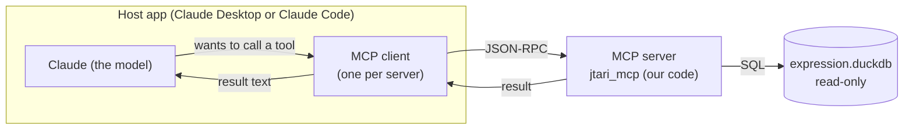
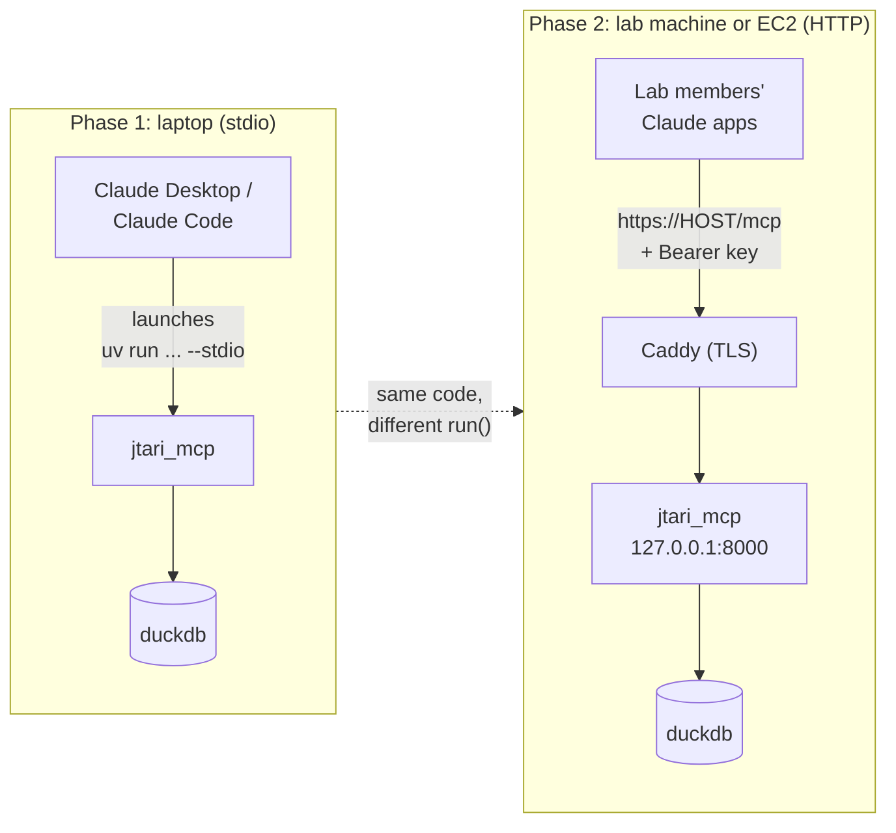
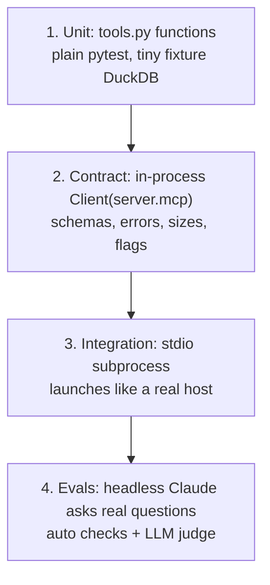
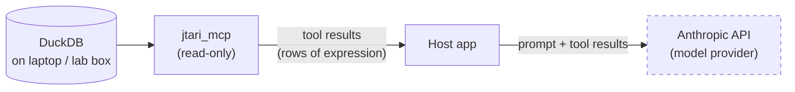

# Learning MCP by building the JTARI RNA-seq server

A guide for a bioinformatician who knows Python, R, SLURM and nf-core but has
not built an MCP server. By the end you should be able to build the next one
yourself. The running example is the JTARI expression server planned in this
repo.

> **Status (2026-10-12):** planning. Nothing under `src/`, `scripts/` or
> `tests/` exists yet. Paths marked *(planned)* are where the code will go.
> SDK facts below were checked against **`mcp` 2.3.0** (PyPI, 2026-10-02) in a
> scratch venv; the hello-world in section 7 was run in-process and over stdio.

Diagrams use Mermaid (renders on GitHub and in VS Code with a Mermaid
extension). The code blocks are written to be readable as plain text too.

---

## Contents

1. [What MCP is and what problem it solves](#1-what-mcp-is-and-what-problem-it-solves)
2. [The three primitives: tools, resources, prompts](#2-the-three-primitives-tools-resources-prompts)
3. [Transports: stdio and Streamable HTTP](#3-transports-stdio-and-streamable-http)
4. [Lifecycle: from connect to answer](#4-lifecycle-from-connect-to-answer)
5. [A tool description is a prompt](#5-a-tool-description-is-a-prompt)
6. [Designing what a tool returns](#6-designing-what-a-tool-returns)
7. [Hello world, registration and the Inspector](#7-hello-world-registration-and-the-inspector)
8. [Testing](#8-testing)
9. [Security and data governance](#9-security-and-data-governance)
10. [Glossary and where to look in this repo](#10-glossary-and-where-to-look-in-this-repo)

---

## 1. What MCP is and what problem it solves

### The problem

We have one DuckDB file holding harmonized expression for ~679 lung
adenocarcinoma cell-line samples:

| Dataset | Samples | Design |
|---|---:|---|
| LOCAL | 234 | Unpublished resistant series (in-house) |
| E-MTAB-11304 | 60 | NL20 isogenic, ALK-fusion transgene |
| E-MTAB-11342 | 90 | CUTO/YU lines × alectinib / brigatinib / lorlatinib × 6 h / 24 h |
| E-MTAB-11834 | 120 | CUTO / H2228 / H3122 × lorlatinib / trametinib |
| FL3C | 175 | Baseline panel |

All five were run through nf-core/rnaseq 3.14.0 (`star_rsem`) against Ensembl
GRCh38 release 113.

Claude cannot see that file. It runs on Anthropic's servers; the DuckDB file is
on your laptop. Pasting tables into a chat does not scale and loses the
metadata. What we want is for Claude to *ask our code* for exactly the numbers
it needs, with the context attached.

### The idea

**MCP (Model Context Protocol)** is a standard contract between an AI app and
a program you write. Your program says "here are the operations I offer, here
are their inputs, here is what they mean". The app lets the model call them.

The closest thing you already know is an **nf-core module**:

| nf-core module | MCP server |
|---|---|
| `meta.yml` declares inputs, outputs, descriptions | Each tool declares name, description, input schema |
| `main.nf` does the work; the pipeline doesn't care how | Your Python function does the work; the model doesn't care how |
| Any pipeline that honours the contract can use the module | Any MCP client (Claude Desktop, Claude Code, others) can use the server |
| `nextflow_schema.json` validates params before the run | The SDK validates arguments against the schema before your code runs |

You write the server once; every MCP-speaking app can use it.

### Host, client, server



- **Host**: the application the user talks to. For us: **Claude Desktop** and
  **Claude Code** (later, possibly Claude Science via a remote connector).
- **Client**: the part of the host that speaks MCP to one server. You don't
  write it.
- **Server**: our program. It publishes tools and answers calls. **Claude never
  touches the database**; it can only call the tools we publish, and we decide
  what comes back. That is why the server can be read-only and why the answers
  stay grounded in real numbers.

---

## 2. The three primitives: tools, resources, prompts

MCP gives a server three kinds of things to offer. They differ in **who
decides when they are used**.

| Primitive | Who triggers it | Analogy | JTARI pieces |
|---|---|---|---|
| **Tool** | The **model** decides to call it, with arguments it chooses | A function in an R package the model can call | `describe_metadata`, `find_samples`, `resolve_genes`, `get_expression`, `contrast`, `dataset_summary` |
| **Resource** | The **app or user** attaches it (e.g. an @-mention) | A file in `docs/` you point a colleague to | metadata schema doc, dataset inventory, "how to interpret results" note |
| **Prompt** | The **user** picks it from a menu | A saved R Markdown template | none planned for v1 (maybe "compare two lines" later) |

### Why the JTARI pieces are split this way

- Everything Claude needs to **compute an answer** is a tool, because only
  tools are reliably reachable by the model on its own.
- The schema doc, inventory and interpretation note are **reference reading**,
  so they are resources.

### The catch with resources

Most hosts (Claude Desktop and Claude Code included) let the **user** attach a
resource; the model does **not** read them on its own initiative. So:

> Any rule Claude must follow (units, "TPM is not comparable across datasets",
> minimum replicates) must live in the **server instructions** and the **tool
> descriptions**. Resources are the long-form backup, not the rulebook.

A practical trick: have `describe_metadata` and `dataset_summary` include the
key interpretation notes in their output, so the model sees them through a
tool call even if nobody attaches the resource.

In code (verified API) the three look like this:

```python
@mcp.tool(annotations=READ_ONLY)
def dataset_summary() -> TextContent: ...

@mcp.resource("jtari://schema", mime_type="text/markdown",
              description="Tables, columns, units")
def schema_doc() -> str: ...

@mcp.prompt()
def compare_lines(a: str, b: str) -> str:
    """Compare two cell lines."""
    return f"Compare {a} vs {b} using contrast."
```

---

## 3. Transports: stdio and Streamable HTTP

A transport is just *how the JSON-RPC messages travel*. Your tool code is the
same for both.

| | **stdio** | **Streamable HTTP** |
|---|---|---|
| Who starts the server | The host launches your process as a child | You run it as a long-lived service |
| Messages travel over | The child's stdin / stdout pipes | HTTP POSTs to `https://host/mcp` |
| Analogy | `samtools view x.bam \| python parse.py`: two processes joined by a pipe | A service on a lab box that anyone with the URL and a key can call |
| SLURM analogy | An interactive `srun --pty` session: lives and dies with you | A long-running service job that others connect to |
| Who can reach it | Only the person whose host launched it | Anyone who can reach the URL, so **auth is required** |
| Lifetime | Ends when the host quits | Runs until you stop it (systemd) |

### The one stdio rule: never print to stdout

In stdio mode, **stdout is the protocol channel**. Every byte on stdout must be
a JSON-RPC message. A stray `print("loaded 679 samples")` lands in the middle
of the stream, the host fails to parse it, and the connection breaks, often
with a vague "server disconnected" message.

```python
import logging, sys
logging.basicConfig(stream=sys.stderr, level=logging.INFO)   # stderr is safe
log = logging.getLogger("jtari_mcp")

print("debug")          # WRONG in a stdio server: corrupts the protocol stream
log.info("debug")       # right: stderr goes to the host's log file
```

The same goes for libraries that print progress bars or warnings to stdout.
In v2 of the SDK, `ctx.info()` / `ctx.log()` still work but are deprecated
(spec 2026-07-28 deprecated the protocol's logging capability), so use plain
`logging` to stderr.

### JTARI's path



```python
mcp.run(transport="stdio")                      # phase 1

app = mcp.streamable_http_app(                  # phase 2 (verified kwargs)
    stateless_http=True, json_response=True,
    transport_security=TransportSecuritySettings(
        enable_dns_rebinding_protection=True,
        allowed_hosts=["127.0.0.1", "127.0.0.1:*", "localhost", "localhost:*",
                       PUBLIC_HOST, f"{PUBLIC_HOST}:*"]))
uvicorn.run(app, host="127.0.0.1", port=8000)   # Caddy terminates TLS in front
```

DSS3 lesson: `allowed_hosts` must include the public hostname, or requests
forwarded by the reverse proxy are refused with HTTP 421.

---

## 4. Lifecycle: from connect to answer

### The messages

MCP messages are JSON-RPC 2.0: small JSON objects with a `method`, `params`
and an `id`. A call looks like:

```json
{"jsonrpc":"2.0","id":7,"method":"tools/call",
 "params":{"name":"resolve_genes","arguments":{"queries":["ALK"]}}}
```

and the reply:

```json
{"jsonrpc":"2.0","id":7,"result":{"isError":false,
 "content":[{"type":"text","text":"{\"resolved\":[{\"query\":\"ALK\",\"gene_id\":\"ENSG00000171094\",\"symbol\":\"ALK\"}]}"}]}}
```

You never write these by hand; the SDK does. Knowing their shape helps when
you read logs or the Inspector.

### The phases

1. **Connect and handshake.** The client asks what the server offers. In the
   older protocol versions (still used by Claude Desktop/Code today) this is
   `initialize`; the newest spec (2026-07-28) is stateless and uses
   `server/discover`. The SDK handles both. Either way the server sends back
   its **capabilities** (tools, resources, prompts) and its **instructions**.
2. **`tools/list`.** The client fetches every tool's name, description and
   input schema and puts them in front of the model.
3. **`tools/call`.** The model decides to call a tool with arguments; the
   client sends it; the SDK validates the arguments against the schema, runs
   your function, and sends back the result (or an error).
4. Steps 3 repeat as many times as the model needs, then it writes the answer.

### One question, end to end

User: *"What is the log2 fold change of ALK under lorlatinib in CUTO8?"*

```mermaid
sequenceDiagram
    actor U as User
    participant H as Host (Claude Desktop)
    participant M as Claude (model)
    participant S as jtari_mcp server
    participant D as DuckDB (read-only)

    Note over H,S: at startup
    H->>S: launch process (stdio), handshake
    S-->>H: capabilities + instructions
    H->>S: tools/list
    S-->>H: 6 tools (name, description, input schema)

    U->>H: "log2FC of ALK under lorlatinib in CUTO8?"
    H->>M: question + instructions + tool list
    M->>H: call resolve_genes(queries=["ALK"])
    H->>S: tools/call resolve_genes
    S->>D: SELECT ... FROM genes WHERE symbol/alias/id matches
    D-->>S: ENSG00000171094
    S-->>H: {"resolved":[{"query":"ALK","gene_id":"ENSG00000171094",...}]}
    H->>M: result
    M->>H: call contrast(gene_ids=["ENSG00000171094"], cell_line="CUTO8", treatment="lorlatinib", reference="DMSO")
    H->>S: tools/call contrast
    S->>D: per-dataset, per-timepoint groups; compute log2FC
    D-->>S: rows
    S-->>H: one row per dataset × timepoint, with n, batch, flags
    H->>M: result
    M-->>U: answer, reported per dataset and timepoint
```

Things this diagram shows that matter in practice:

- The model **resolves the gene first** because the instructions say "never
  guess gene IDs". It will only do that if we write it down (section 5).
- Lorlatinib-treated CUTO samples may exist in **two** datasets
  (E-MTAB-11342 and E-MTAB-11834). `contrast` should compare within a dataset
  and return one row per dataset × timepoint, never pool them. The model
  should then report them separately. Again: only if the tool output and the
  instructions make that obvious.
- The argument names for `contrast` above are illustrative; the real signature
  is still being designed.

---

## 5. A tool description is a prompt

The model chooses and parameterizes tools using **only three things**:

1. the tool **name**,
2. its **description** (in Python, the docstring),
3. its **input schema** (generated from your type hints).

There is no other trigger. It does not read your code. So the docstring is not
documentation for developers; it is **a prompt for the model**.

### Bad vs good: `get_expression`

Bad:

```python
@mcp.tool()
def get_expression(genes, filters=None, unit="tpm", limit=100):
    """Get expression data."""
```

The model doesn't know what a gene should look like, what `filters` accepts,
what the units mean, or that comparing TPM across datasets is unsafe. It will
guess, and its guesses will look plausible.

Good:

```python
@mcp.tool(annotations=READ_ONLY)
def get_expression(
    genes: Annotated[list[str], Field(
        description="Ensembl gene IDs from resolve_genes, e.g. ['ENSG00000171094']",
        max_length=50)],
    dataset: Literal["LOCAL", "E-MTAB-11304", "E-MTAB-11342",
                     "E-MTAB-11834", "FL3C"] | None = None,
    filters: Annotated[dict[str, str | list[str]] | None, Field(
        description="metadata column -> value or list of values, e.g. "
                    "{'cell_line': 'CUTO8', 'treatment': ['DMSO','lorlatinib']}. "
                    "AND across keys, OR within a list. Valid columns: describe_metadata.")] = None,
    unit: Literal["tpm", "log2_tpm1"] = "log2_tpm1",
    limit: Annotated[int, Field(ge=1, le=500)] = 100,
    offset: Annotated[int, Field(ge=0)] = 0,
) -> TextContent:
    """Per-sample expression for up to 50 genes.

    Use for questions like "show ALK expression in the NL20 samples".
    Call resolve_genes first; never guess gene IDs.

    Returns one row per sample x gene with dataset, batch, cell_line, treatment,
    time_h and identity_status on every row, in the requested unit
    (log2(TPM+1) by default). Paged: check `complete` and `total_rows`.

    TPM is not comparable across datasets (different library preps and
    batches). Compare within one dataset, or use `contrast`, which computes
    fold changes within each dataset. Do not quote totals from a page where
    complete=false.
    """
```

### Types become schema the model sees

| Python | JSON Schema the model receives | Effect |
|---|---|---|
| `Literal["tpm", "log2_tpm1"]` | `"enum": ["tpm", "log2_tpm1"]` | The model sees the only allowed values |
| `Annotated[int, Field(ge=1, le=500)]` | `"minimum": 1, "maximum": 500` | Bad values rejected **before** your code runs, with a readable message |
| `Annotated[list[str], Field(max_length=50)]` | `"maxItems": 50` | Caps enforced in the schema |
| `Field(description="...")` | per-parameter `"description"` | A mini-prompt per argument; include an example value |
| `dict[str, str \| list[str]]` | object with string / array values | Flexible filters without 40 parameters |

Use explicit `Literal` parameters for small, stable vocabularies (dataset,
unit) and the `filters` dict for the long tail. Validate dict keys against the
metadata catalogue and raise a `ToolError` listing valid keys when one is
wrong.

### Server instructions: the domain rulebook

`MCPServer(instructions=...)` is sent once at connect and shapes every answer.
It is the most important text in the project. Draft outline for JTARI:

```text
SCOPE      5 datasets of LUAD cell-line RNA-seq (list), nf-core/rnaseq 3.14.0
           star_rsem, Ensembl GRCh38 r113. Nothing else.
WORKFLOW   describe_metadata for valid columns/values; resolve_genes before any
           expression call; never guess sample or gene IDs.
UNITS      TPM and log2(TPM+1). State the unit with every number.
RULES      "Differential" means |log2FC| >= X with n >= 2 per group, within
           one dataset. TPM is not comparable across datasets. A cell line is
           not a sample: group replicates. ALK signal in E-MTAB-11304 includes
           the transgene. (Exact thresholds: to be agreed with the PI.)
DON'T      Never infer values the tools did not return. Never quote totals from
           complete=false pages. Report datasets, treatments and timepoints
           separately. Flag rows whose identity_status is not "confirmed".
```

### The DSS3 lesson: undefined rules get invented

In DSS3, the instructions did not define what a "reliable" hit was. Claude
built its own four-rule filter and silently dropped the best hits. Every
domain word that a user might use ("expressed", "high", "resistant",
"differential", "reliable") needs a definition in the instructions, or the
model will make one up. Describe **how to read fields**, not what the data
currently contains; observations go stale and bias the model.

---

## 6. Designing what a tool returns

Think of a tool reply as a file you're handing to a careful colleague who will
read every byte and cannot ask you questions. It also costs context: Claude
Code warns above **~10k tokens** per tool result, caps at **25k tokens** by
default, and saves text over **50,000 characters** to a file instead of
showing it inline.

### The envelope

For table-shaped results, return one compact JSON object with metadata plus a
CSV string for the rows:

```json
{"unit":"log2(TPM+1)","filters_applied":{"cell_line":["CUTO8"],"treatment":["lorlatinib","DMSO"]},
 "total_rows":48,"returned":48,"complete":true,"next_offset":null,
 "columns":["sample_id","dataset","batch","cell_line","treatment","time_h","identity_status","gene","value"],
 "rows_csv":"sample_id,dataset,batch,...\nS0412,E-MTAB-11342,b2,...\n",
 "notes":["TPM is not comparable across datasets; compare within dataset."]}
```

### Rules, each with its reason

| Rule | Why |
|---|---|
| Compact JSON (`separators=(",",":")`), returned as `TextContent` | The SDK pretty-prints dicts and pydantic models with `indent=2`, and structured output sends the data **twice**. DSS3: 200 rows × 20 fields indented was ~35k tokens and Claude Code wouldn't show it |
| CSV string for rows | Column names once, not per row; ~5–7× smaller than a list of dicts |
| Row caps: `limit` default 100, schema max 500, plus a byte budget | Keeps every reply under ~40k chars |
| `total_rows`, `returned`, `complete`, `next_offset` | DSS3: Claude computed totals from truncated lists. With these flags plus an instruction, it stops |
| A summary mode (e.g. per-group n / median / IQR) | Most questions need groups, not 600 rows |
| Context columns on **every** row: `dataset`, `batch`, `treatment`, `time_h`, `identity_status` | DSS3: treated and untreated samples got mixed because the condition wasn't on the row. The model only knows what's in the reply |
| Echo `filters_applied` after normalisation | The model (and you, debugging) can see what was actually matched |
| NaN / inf → `null`; `json.dumps(..., allow_nan=False)` | NaN is not valid JSON; `allow_nan=False` makes a stray one fail loudly in tests |
| ~4 significant figures, not fixed decimals | DSS3: tiny values rounded to `0.0`. Sig figs keep `3.2e-05` |
| Unit in every reply | Never make the model remember it from an earlier call |

Verified helper:

```python
def reply(d: dict) -> TextContent:
    return TextContent(type="text",
                       text=json.dumps(d, separators=(",", ":"), allow_nan=False))
```

### Errors the model can act on

| You raise | The model sees |
|---|---|
| `ToolError("No gene matches 'ALKK'. Did you mean ALK? Call resolve_genes first.")` | `is_error=true`, text `Error executing tool get_expression: No gene matches 'ALKK'. Did you mean ALK? ...` |
| Any other exception (`KeyError`, DuckDB error) | Only `Error executing tool get_expression`. No message; traceback goes to your stderr log |
| Out-of-range argument (e.g. `limit=5000`) | SDK validation message naming the field and the limit; your code never runs |

So: expected failures (unknown gene, ambiguous name, unknown filter key, no
samples match) → `ToolError` with a suggestion. Pattern from DSS3: `tools.py`
raises its own plain exception class; a thin `_call()` wrapper in `server.py`
converts it to `ToolError`. For ambiguous names, **return the candidates**;
never silently pick one.

```python
from mcp.server.mcpserver.exceptions import ToolError
```

(Don't raise `MCPError` from a tool: in v2 that becomes a protocol-level error,
not a readable tool failure.)

---

## 7. Hello world, registration and the Inspector

### The smallest useful server

This ran against `mcp` 2.3.0 both in-process and over stdio (protocol version
negotiated: `2026-07-28`):

```python
"""hello_server.py: the smallest useful MCP server (stdio)."""
import logging
import sys

from mcp.server.mcpserver import MCPServer
from mcp.server.mcpserver.exceptions import ToolError
from mcp.types import ToolAnnotations

logging.basicConfig(stream=sys.stderr, level=logging.INFO)   # never stdout
log = logging.getLogger("hello")

mcp = MCPServer(
    name="jtari-hello",
    instructions="Toy server. Gene lengths are made up; say so if asked.",
)

FAKE_LENGTHS = {"ALK": 6265, "EGFR": 9905, "KRAS": 5430}

@mcp.tool(annotations=ToolAnnotations(read_only_hint=True))
def gene_length(symbol: str) -> str:
    """Return the (fake) transcript length in bp for one HGNC gene symbol, e.g. 'ALK'."""
    log.info("gene_length(%s)", symbol)                 # goes to stderr
    try:
        return f"{symbol.upper()}: {FAKE_LENGTHS[symbol.upper()]} bp"
    except KeyError:
        raise ToolError(f"Unknown symbol {symbol!r}. Known: {sorted(FAKE_LENGTHS)}")

if __name__ == "__main__":
    mcp.run(transport="stdio")
```

Gotchas:

- **It's `MCPServer`, not `FastMCP`.** v1 tutorials (most of the internet)
  use `from mcp.server.fastmcp import FastMCP`; in v2 that import raises
  `ModuleNotFoundError`. If you see `FastMCP` in an example, translate it.
- `@mcp.tool()` needs the parentheses; bare `@mcp.tool` raises `TypeError`.
- **Sync tool functions run on a worker thread** in v2. For DuckDB, open one
  `duckdb.connect(path, read_only=True)` at startup and take a `con.cursor()`
  per call; don't share one connection across concurrent calls.
- Running it in a terminal shows nothing and waits. That's correct: it's
  waiting for JSON-RPC on stdin. Ctrl-C to quit. Use the Inspector instead.

### Getting `uv`

`uv` is not installed on this Mac yet. Install once:

```bash
curl -LsSf https://astral.sh/uv/install.sh | sh     # installs ~/.local/bin/uv
```

`uv run --directory /path/to/repo python -m jtari_mcp.server` creates/updates
the project venv from `pyproject.toml` (`mcp>=2.3,<3`) and runs the module in
it, which is exactly what a host needs: one command, no "activate" step. Think
of it as the conda env and the `module load` folded into the command line.

The fallback, used by DSS3, is an absolute path to a venv/conda Python:
`"command": "/abs/path/.venv/bin/python"`.

### Claude Desktop

Edit `~/Library/Application Support/Claude/claude_desktop_config.json`. The
file currently has no `mcpServers` key; add one at the top level, then **quit
and restart** Desktop.

```json
{
  "mcpServers": {
    "jtari-rnaseq": {
      "command": "/Users/<you>/.local/bin/uv",
      "args": ["run", "--directory", "/Users/<you>/2026-09-JTARI-RNA-MCP",
               "python", "-m", "jtari_mcp.server", "--stdio"],
      "env": {"JTARI_DB": "/Users/<you>/2026-09-JTARI-RNA-MCP/data/expression.duckdb",
              "JTARI_MCP_LOG_LEVEL": "WARNING"}
    }
  }
}
```

**Absolute paths everywhere.** Desktop is a GUI app; it does not inherit your
shell's `PATH` or working directory, so `uv` alone or a relative path fails.
(Env var names are provisional.)

Remote servers in Desktop go through Settings → Connectors → Add custom
connector, which needs a **public https URL** and OAuth. That's phase 2.

### Claude Code

```bash
# local scope (default): only you, only this project
claude mcp add jtari-rnaseq -e JTARI_MCP_LOG_LEVEL=WARNING -- \
  uv run --directory /Users/<you>/2026-09-JTARI-RNA-MCP \
  python -m jtari_mcp.server --stdio

# check it
claude mcp list

# phase 2: remote HTTP with a personal key
claude mcp add -t http -s user jtari-rnaseq https://HOST/mcp \
  -H "Authorization: Bearer $JTARI_MCP_KEY"
```

Everything after `--` is the command Claude Code will launch. Scopes: `local`
(default), `project` (writes `.mcp.json` in the repo; teammates approve it),
`user` (all your projects). `claude mcp add-from-claude-desktop` imports the
Desktop entry.

In Claude Code, tools appear as `mcp__jtari-rnaseq__get_expression`; `/mcp`
shows connection status.

### The MCP Inspector

The Inspector is a small web UI that acts as an MCP client: you can list
tools, read their schemas, call them with hand-typed arguments and see the raw
replies. It's the equivalent of running one nf-core module with `-stub` or a
test profile before wiring it into a pipeline.

```bash
npx @modelcontextprotocol/inspector \
  uv run --directory /Users/<you>/2026-09-JTARI-RNA-MCP python -m jtari_mcp.server --stdio
```

It needs Node (`npx`). Check in it: the instructions text, each tool's
schema (are the enums and maxima there?), a `ToolError` path, and reply sizes.
(Not yet run in this project; confirm it negotiates with mcp 2.3.0 when we
first try it.)

---

## 8. Testing

Four layers, cheapest first. Same idea as testing an nf-core module: unit test
the script, then the module contract, then the pipeline run, then check the
biology.



### 1. Plain functions, no MCP

Keep query logic in `tools.py` with **no MCP imports**. Then it's ordinary
Python:

```python
def test_contrast_within_dataset(fixture_db):
    out = tools.contrast(fixture_db, gene_ids=["ENSG00000171094"],
                         cell_line="CUTO8", treatment="lorlatinib")
    assert {r["dataset"] for r in out["rows"]} <= {"E-MTAB-11342", "E-MTAB-11834"}
    assert all(r["n_treated"] >= 2 for r in out["rows"])
```

Expected values come from an **independent route** (pandas on the raw RSEM
tables, not the MCP code), so a pass means "MCP agrees with the source", not
"MCP agrees with itself".

### 2. In-process MCP client

`Client` accepts the server object directly: no subprocess, no pipes, fast.
This tests what the model will see (verified API):

```python
import pytest
from mcp.client import Client
from jtari_mcp import server

@pytest.mark.anyio
async def test_contract():
    async with Client(server.mcp) as c:
        assert "resolve_genes" in c.instructions
        tools = {t.name: t for t in (await c.list_tools()).tools}
        assert tools["get_expression"].annotations.read_only_hint
        assert tools["get_expression"].input_schema["properties"]["limit"]["maximum"] == 500
        r = await c.call_tool("get_expression", {"genes": ["NOT_A_GENE"]})
        assert r.is_error and "resolve_genes" in r.content[0].text
```

Also check: no `NaN` in any reply, every reply under the size budget,
`complete`/`total_rows` correct on a paged call, context columns present on
every row.

### 3. stdio integration

Proves the server actually launches the way Desktop/Code will launch it, and
that nothing writes to stdout:

```python
from mcp import StdioServerParameters
params = StdioServerParameters(command=sys.executable,
                               args=["-m", "jtari_mcp.server", "--stdio"],
                               env={**os.environ, "JTARI_DB": str(fixture_path)})
async with Client(params, read_timeout_seconds=60) as c:
    r = await c.call_tool("dataset_summary", {})
```

When we deploy over HTTP, add an HTTP subprocess test: no key → 401, wrong
Host header → 421, valid key works.

### 4. Evals: does Claude answer correctly?

Unit tests prove the numbers are right. Evals prove **Claude uses them
correctly**. From the playbook:

```bash
cd "$(mktemp -d)"     # empty folder: Claude can't read our repo, like a lab member
claude -p "Is ALK induced by lorlatinib in CUTO8?" \
  --output-format stream-json --verbose \
  --mcp-config mcp.json --strict-mcp-config \
  --allowedTools "mcp__jtari-rnaseq__*" \
  --system-prompt "You are a helpful assistant." \
  --no-session-persistence
```

- **Neutral system prompt**: the rules must come from our server instructions.
- Record which tools were called with which arguments, plus the final answer.
- Grade with automatic checks (right tool, numbers within tolerance) and an
  LLM judge for behaviour (one rule per case: "reported the two datasets
  separately", "did not compare TPM across datasets").
- Categories: lookups, filters, cross-dataset traps, ambiguity, missing data,
  domain rules.
- Run each case 3–5 times; look at pass rates.
- **Read failing answers before changing anything.** In DSS3 half the early
  "failures" were wrong expectations, not model errors.
- Roughly $0.2–0.3 per question at list price.

---

## 9. Security and data governance



| Concern | What we do |
|---|---|
| **stdio is local** | Only the person whose host launched the process can talk to it. No key needed |
| **HTTP is reachable by others** | Every request needs `Authorization: Bearer <key>`; no/wrong key → 401. Keys stored hashed, outside the repo. Server **refuses to start** in HTTP mode without a keys file (fail closed). Bind to 127.0.0.1; Caddy provides TLS in front. Later: UMich Okta via OAuth |
| **Read-only** | `duckdb.connect(path, read_only=True)`; every tool annotated `read_only_hint=True`; no tool takes SQL |
| **SQL injection** | Filter keys are mapped through a whitelist of column names; values are bound as `?` parameters, never formatted into the SQL string |
| **Secrets** | Keys in macOS Keychain or env vars, never in git or in a chat |

### Data leaves the building

This is the part that is easy to miss:

> **Every tool result is sent to the model provider (Anthropic) as part of the
> conversation.** If Claude calls `get_expression` on LOCAL samples, those
> expression values leave UMich.

The four public datasets (E-MTAB-11304, -11342, -11834; FL3C if public) are
low-risk. The **LOCAL** series (234 samples) is **unpublished**. Before LOCAL
data is served through this MCP, **get explicit sign-off from the PI / data
steward** (playbook §1). Until then, the build script or the server should be
able to exclude LOCAL (e.g. a build flag or an allow-list of datasets), and
the test suite should check that the exclusion holds.

---

## 10. Glossary and where to look in this repo

### Glossary

| Term | Meaning |
|---|---|
| **MCP** | Model Context Protocol: the standard contract between AI apps and programs that offer tools/data |
| **Host** | The app the user talks to (Claude Desktop, Claude Code) |
| **Client** | The part of the host that speaks MCP to one server |
| **Server** | Our program (`jtari_mcp`), which publishes tools/resources and answers calls |
| **Tool** | A function the model can call with arguments it chooses |
| **Resource** | Read-only content (by URI) the user/app can attach |
| **Prompt** | A user-selected message template offered by the server |
| **Instructions** | Server-level text sent at connect: scope, workflow, domain rules |
| **Input schema** | JSON Schema of a tool's arguments, generated from Python type hints |
| **Annotations** | Hints about a tool's behaviour, e.g. `read_only_hint=True` |
| **JSON-RPC** | The message format: `{"jsonrpc":"2.0","id":..,"method":..,"params":..}` |
| **stdio transport** | Host launches the server; messages over stdin/stdout |
| **Streamable HTTP** | Server runs as a service; messages as HTTP POSTs to `/mcp` |
| **`ToolError`** | SDK exception whose message the model sees; use for expected failures |
| **`TextContent`** | A text block in a tool result; we use it to return compact JSON |
| **`MCPServer`** | The v2 SDK server class (was `FastMCP` in v1) |
| **Inspector** | Web UI client for poking a server by hand |
| **Eval** | A real question run through headless Claude, graded automatically and by a judge |
| **`complete` flag** | `false` when a reply is a page or was truncated; totals must come from `total_rows` |
| **identity_status** | Per-sample flag for cell-line identity confirmation; carried on every row |

### Where to look in this repo *(all planned)*

| Piece | Path |
|---|---|
| This guide | `docs/LEARNING.md` |
| Build the DuckDB from nf-core outputs (RSEM tables + metadata), deterministic | `scripts/build_db.py` *(planned)* |
| Read-only DuckDB connection, cursors, column whitelist | `src/jtari_mcp/db.py` *(planned)* |
| Query logic, plain Python, no MCP imports | `src/jtari_mcp/tools.py` *(planned)* |
| `MCPServer`, instructions, tool wrappers, `ToolError` translation, stdio/HTTP startup | `src/jtari_mcp/server.py` *(planned)* |
| Unit, contract and stdio tests; fixture DuckDB | `tests/` *(planned)* |
| Eval cases and runner | `tests/evals/` *(planned)* |

### Further reading

- The JTARI MCP playbook: lessons from DSS3, build order,
  checklists.
- DSS3's `mcp_server/server.py` and `tools.py`: a working
  server with the same layout (on mcp 2.2; same API).
- DSS3's `docs/MCP_WORKFLOW_EXPLAINED.md`: the end-to-end
  explainer for DSS3.
- SDK v1 → v2 migration guide: https://py.sdk.modelcontextprotocol.io/v2/migration/
